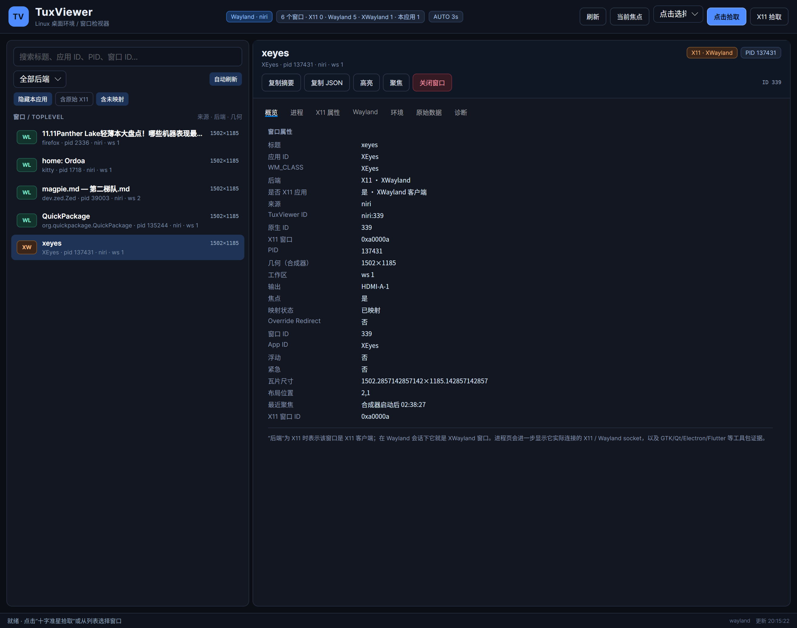
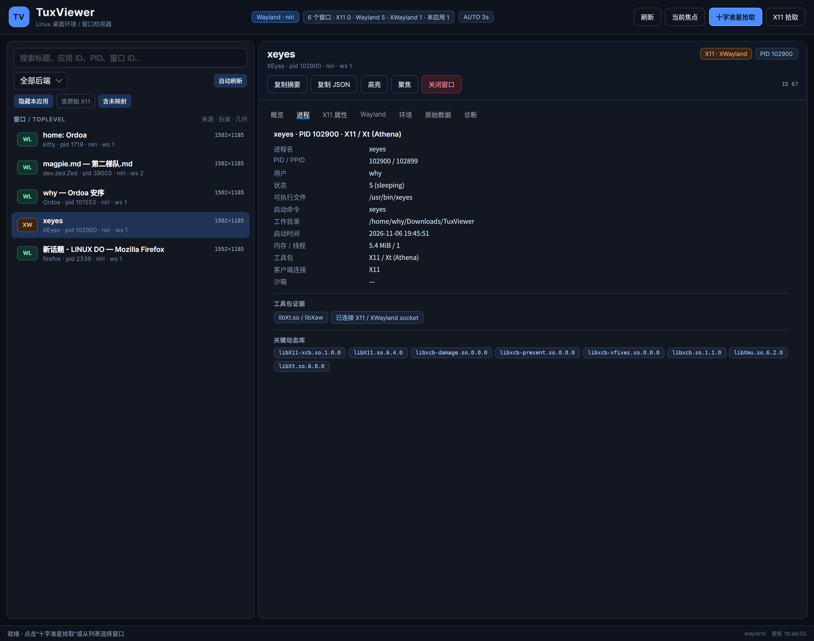

# TuxViewer

> Linux 桌面环境 / 窗口检视器，Spy++ 风格的 Wayland + X11 窗口分析工具。  
> C# 14 · .NET 10 · Avalonia 12（Wayland 后端 + X11 回退）· Linux Only





TuxViewer 用于回答这些问题：

- 这个窗口是 **X11 / XWayland 应用**，还是 **Wayland 原生应用**？
- 它属于哪个进程、用什么 UI 工具包（GTK/Qt/Electron/Flutter/Avalonia/SDL…）？
- 它的窗口 ID、WM_CLASS、几何、工作区、X11 属性、子窗口、事件掩码是什么？
- 它当前连接的是 **X11 socket** 还是 **Wayland socket**？有没有 PipeWire / D-Bus？
- 当前会话是哪个合成器 / WM？支持哪些 Wayland 协议？

---

## 功能

### 1. 跨桌面环境 / 窗口管理器

| 环境 | 窗口枚举 | 拾取能力 | 聚焦 / 关闭 | 说明 |
|---|---|---|---|---|
| **X11 会话（任意 WM/DE）** | ✅ 全量 top-level | ✅ 点击 + 拖动 + 实时高亮 | ✅ / ✅ | Xlib 直接读取 `_NET_CLIENT_LIST`、属性、子窗口 |
| **niri** | ✅ IPC | ✅ 点击式原生十字；XWayland 可走 X11 拖动 | ✅ / ✅ | 自动合并 XWayland 窗口的 X11 详情 |
| **Sway** | ✅ IPC | ⚠️ 聚焦式拾取（3 秒倒计时）；X11 可拖动 | ✅ / ✅ | 读取 `shell=xwayland` 标记 |
| **Hyprland** | ✅ IPC | ⚠️ 指针停留拾取（3 秒倒计时）；X11 可拖动 | ✅ / ✅ | 使用 `xwayland` 字段 |
| **KDE Plasma / KWin** | ⚠️ 仅拾取 | ✅ `org.kde.KWin.queryWindowInfo` 原生十字 | ✗ / ✗ | KWin 不向普通客户端暴露窗口列表 |
| **GNOME Shell** | ✅ 可选扩展 | ⚠️ 指针停留拾取（3 秒倒计时）；X11 可拖动 | ✅ / ✅ | 需安装 TuxViewer GNOME 扩展 |
| **其他 wlroots（labwc / wayfire / river…）** | ✅ `wlrctl` | ✗ | ✅ / ✅ | foreign-toplevel 协议没有 PID/几何 |
| **Weston / COSMIC 等** | ⚠️ 仅 XWayland | ⚠️ 仅 X11 回退 | 视后端 | 仍可检查 XWayland 应用 |

> Wayland 出于安全设计，不允许普通客户端全局读取其他窗口、抓取输入或截屏。  
> TuxViewer 会为每个合成器选择其官方 IPC / 协议，而不是尝试绕过限制。

### 2. X11 / XWayland 深度检视

- 窗口树 / 顶层窗口列表（`_NET_CLIENT_LIST` + root children）
- `_NET_WM_NAME` / `WM_NAME`、`WM_CLASS`、`_NET_WM_PID`
- 全局几何、边框、深度、Map 状态、Override Redirect、InputOnly
- **全部 X11 属性**（Atom 名 / 类型 / format / 值）
- 子窗口递归树（最多 5 层 / 300 个）
- `_NET_WM_WINDOW_TYPE`、`_NET_WM_STATE`、`WM_PROTOCOLS`
- `WM_NORMAL_HINTS`、Transient For、事件掩码
- 高亮边框（X11 Shape 扩展，支持悬停实时高亮和选中后高亮）
- 选中高亮：X11/XWayland 精确边框；niri 用 urgent 边框；Sway 用 urgent；Hyprland 聚焦边框；GNOME 扩展绘制边框
- 发送 `_NET_CLOSE_WINDOW`、`XSetInputFocus`

### 3. Wayland 原生信息

- 合成器原生 JSON（niri / Sway / Hyprland / GNOME 扩展）
- app_id、标题、workspace、output、焦点、浮动 / 全屏 / 最小化
- XWayland 合并：把 compositor toplevel 与 X11 窗口按 X11 id / PID / 标题 / WM_CLASS 关联
- 修正 niri 下 XWayland 窗口 PID 指向 `xwayland-satellite` 的问题（使用 X11 `_NET_WM_PID` 或进程名匹配）

### 4. 进程与“开发技术”识别

- `/proc/<pid>/exe`、cmdline、cwd、用户、状态、内存、线程、启动时间
- 完整环境变量（优先显示 `WAYLAND_DISPLAY`、`DISPLAY`、`GDK_BACKEND`、`QT_QPA_PLATFORM` 等）
- 关键动态库列表
- 工具包 / 框架识别：
  - GTK 2/3/4、libadwaita、Qt 5/6
  - Electron、Chromium/CEF、Firefox/Gecko、Flutter
  - Avalonia、Wine、Java AWT/Swing
  - SDL2/3、GLFW、Tk、wxWidgets、EFL、FLTK、FOX、Motif
  - X11 / Xt（Athena）、原生 Wayland 客户端
- **真实连接检测**：
  - 读取 `/proc/<pid>/fd` + `/proc/net/unix`
  - 通过 `ss -x -p` 的 **peer inode** 识别 Wayland 客户端侧“未命名 socket”
  - 区分 X11 / Wayland / D-Bus / PipeWire / PulseAudio
- Flatpak / Snap / AppImage 环境识别

### 5. 交互与工作流

- 窗口列表：应用图标、WL/X11 标签、搜索、后端筛选、隐藏本应用、包含原始 X11 窗口、包含未映射窗口
- **窗口层次树**：按应用 / 进程 / 工作区分组或平铺，展开 X11 toplevel 的子窗口并点击检视；支持“仅此 PID”过滤
- **实时事件监控**：X11 `PropertyNotify` / `ConfigureNotify` / `Map` / `Destroy` / `Focus`，niri event-stream、Sway subscribe、Hyprland socket2
- 属性变化即时刷新，并在“概览”“X11 属性”中标黄显示旧值 → 新值
- “事件”页保留最近 800 条实时事件，可清空 / 复制
- 图标优先从 `.desktop` / 图标主题解析；无法解析时显示应用首字母占位
- **两种拾取模式**：
  - **点击拾取**：出现十字准星，悬停高亮，单击确认
  - **拖动拾取**：按住左键拖动准星，拖动过程中实时高亮，松开确认
- 自动刷新兜底：实时事件可用时 15 秒，否则 3 秒（可关闭）
- 拾取后自动定位详情，并自动高亮选中窗口
- 复制摘要 / 完整 JSON
- **选中窗口截图**：X11 / XWayland 用 `XGetImage` 精确捕获；niri 用 `screenshot-window`；Sway / Hyprland 用 `grim`；支持预览、保存 PNG、复制图片
- **一键生成窗口规则**：根据选中窗口生成 niri `window-rule`、Sway `for_window`、Hyprland `windowrulev2`，可勾选浮动 / 全屏 / 无边框 / sticky / 尺寸 / 工作区 / 透明度
- **X11 事件监视器（XRecord）**：全局记录键盘、鼠标、Configure、Property、Focus、Map/Unmap、ClientMessage；无需修改目标窗口 event mask，支持分类过滤和“只监视选中窗口”
- **AT-SPI2 控件树**：通过 `python3-gi` 读取 GTK/Qt 应用的角色、名称、描述和控件层级；应用需启用无障碍桥
- 详情页：概览、进程、X11 属性、Wayland、环境、原始数据、事件、截图、诊断
- 诊断页：会话、后端可用性、Wayland 全局协议、GNOME 扩展安装
- 快捷键：`F2` 点击拾取、`F3` 拖动拾取、`Shift+F2/F3` 强制 X11、`F5` 刷新、`Esc` 取消
- X11 抓取时：点击模式左键单击；拖动模式按住左键拖动后松开；右键 / `Esc` 取消

### 6. CLI / 自动化

```bash
# 文本诊断
TuxViewer --diagnose

# 完整 JSON（会话 + 后端 + Wayland 协议 + 窗口 + 原始数据）
TuxViewer --diagnose --json

# 查看某个窗口的完整检视 JSON（id / native id / app_id / 标题均可）
TuxViewer --diagnose --detail xeyes

# 在 X11 屏幕上高亮并保持 2.5 秒
TuxViewer --diagnose --detail xeyes --highlight

# 命令行 X11 拾取（click / drag），结果输出完整 JSON
TuxViewer --pick-x11 click --json
TuxViewer --pick-x11 drag --json

# 截取指定窗口并保存 PNG
TuxViewer --screenshot xeyes --out xeyes.png

# 启动 GUI 并自动开始 X11 RECORD 录制
TuxViewer --record --tab xrecord
TuxViewer --record --record-selected --select xeyes

# 安装可选 GNOME Shell 扩展
TuxViewer --install-gnome-extension

# 启动 GUI 并预选窗口
TuxViewer --select xeyes

# 强制后端
TUXVIEWER_BACKEND=x11     TuxViewer
TUXVIEWER_BACKEND=wayland TuxViewer
```

---

## 环境要求

- **Linux**（仅 Linux）
- **.NET 10 SDK / Runtime**（项目使用 `net10.0`、`LangVersion=14`）
- **Avalonia 12.1.5**（NuGet 还原）
- 运行库：
  - X11：`libX11.so.6`、`libXext.so.6`、`libXtst.so.6`（XRecord 事件监视）
  - Wayland：`libwayland-client`、`libxkbcommon`（由 Avalonia.Wayland 使用）
- 可选外部命令（按需启用对应后端）：
  - `niri`、`swaymsg`、`hyprctl`、`qdbus`/`qdbus6`、`gdbus`、`gnome-extensions`
  - `wlrctl`（其他 wlroots 合成器）
  - `python3` + `python-gobject`（AT-SPI 控件树）
  - `ss`（iproute2，用于识别客户端侧 Wayland socket）
  - `wayland-info`（诊断页的协议列表）

Arch Linux 示例：

```bash
sudo pacman -S dotnet-sdk libx11 libxext wayland libxkbcommon iproute2
```

---

## 构建 / 运行

```bash
cd TuxViewer

# 开发运行
dotnet run --project src/TuxViewer

# 发布（依赖系统 .NET Runtime）
dotnet publish src/TuxViewer -c Release -r linux-x64 --self-contained false -o dist
./dist/TuxViewer

# 完全自包含发布
dotnet publish src/TuxViewer -c Release -r linux-x64 --self-contained true -o dist
```

安装到用户目录（构建 + 复制 + .desktop + 图标）：

```bash
./scripts/install.sh
```

然后从应用菜单启动 **TuxViewer**，或执行 `~/.local/bin/tuxviewer`。

---

## 使用说明

### 十字准星拾取

1. 直接点击工具栏按钮：
   - **点击拾取**：出现十字准星，悬停即高亮，单击确认。
   - **拖动拾取**：出现十字准星后，在目标窗口按住左键拖动，高亮跟随指针，松开确认。
2. 快捷键：`F2` 点击拾取，`F3` 拖动拾取。
3. 按提示操作：
   - **X11 / XWayland 窗口**：TuxViewer 使用 `XGrabPointer` 全局抓取，支持真正的点击和拖动，悬停 / 拖动时实时绘制边框。
   - **niri / KWin**：调用合成器原生拾取器。niri/KWin 的原生实现是点击式；拖动模式会提示并退化为点击确认。
   - **Hyprland / GNOME**：倒计时 3 秒，把指针移到目标窗口上方，结束后读取指针下窗口。
   - **Sway**：倒计时 3 秒，点击目标窗口使其获得焦点，结束后读取焦点窗口。
4. 拾取完成后窗口会自动加入列表并选中，并为选中的窗口触发一次短时高亮。

> 如果只想检查 X11 / XWayland 窗口，使用 **X11 拾取** 按钮（或 `Shift+F2 / Shift+F3`），即使当前是 Wayland 会话。
> 在 niri 下，原生 Wayland 窗口的拖动式拾取受合成器 API 限制；可通过 **X11 拾取** 对 XWayland 窗口获得完整拖动 + 实时高亮体验。

### 判断“是不是 X11 应用”

详情页右上角徽章与概览中的“后端”：

- `X11`：原生 X11 会话中的 X11 客户端
- `X11 · XWayland`：Wayland 会话中的 XWayland 客户端
- `Wayland`：Wayland 原生客户端

进程页的“客户端连接”进一步给出证据：

- `X11` / `Wayland` / `Wayland + X11`：来自真实 socket 连接
- `（动态库）`：socket 权限不足时根据 `libX11` / `libwayland-client` 推断

> 某些应用同时链接 X11 和 Wayland（例如 kitty、部分 Electron 应用），但实际连接会通过 socket 检测区分。

---

## 技术原理

### 后端选择

- **Avalonia**：`UsePlatformDetect().UseWaylandWithFallback()`  
  优先使用 `WAYLAND_DISPLAY` 对应的原生 Wayland 后端，失败时回退 X11。  
  `TUXVIEWER_BACKEND=x11|wayland` 可强制。
- **X11**：`libX11` / `libXext` P/Invoke，单 Display + 锁串行化，安装自定义 `XErrorHandler` 避免 BadWindow 退出。
- **Wayland**：不试图绕过安全模型，使用合成器公开 API：
  - niri：`niri msg --json ...`
  - Sway：`swaymsg -t get_tree -r`
  - Hyprland：`hyprctl -j ...`
  - KWin：`org.kde.KWin.queryWindowInfo`（交互式选择）
  - GNOME：可选 Shell 扩展 + `gdbus`
  - 其他 wlroots：`wlrctl toplevel list`

### “X11 应用”检测链路

1. X11 窗口本身 → `Backend = X11`
2. Wayland 会话中，合成器 toplevel 与 X11 窗口匹配：
   - 直接 X11 window id（Sway `window`、Hyprland `xwayland`）
   - `_NET_WM_PID`
   - 标题 / WM_CLASS / app_id
   - 合并后 `Backend = X11`、`IsXWayland = true`
3. 进程 socket 检测作为交叉验证
4. 没有 `_NET_WM_PID` 的 X11 客户端（例如 xeyes）通过 `WM_CLASS` ↔ `/proc/<pid>/comm|exe` 匹配

### 工具包识别

扫描 `/proc/<pid>/maps` 中的动态库名，结合环境变量和命令行，按优先级判断；例如：

- `libAvaloniaNative.so` → **Avalonia**
- `libgtk-4.so` → **GTK 4**
- `libQt6Core.so` → **Qt 6**
- `libelectron.so` → **Electron**
- `libflutter_linux_gtk.so` → **Flutter**
- `libXt.so` + `libXaw` → **X11 / Xt (Athena)**（xeyes 等）

---

## 项目结构

```
TuxViewer/
├─ src/TuxViewer/
│  ├─ Program.cs                    # Avalonia 启动 / CLI 诊断
│  ├─ App.axaml(.cs)                # 主题 / 生命周期
│  ├─ Views/MainWindow.axaml(.cs)   # 主界面与事件
│  ├─ ViewModels/                   # MVVM
│  ├─ Models/                       # WindowInfo / ProcessSnapshot / ...
│  ├─ Interop/X11Native.cs          # Xlib / Xext P/Invoke
│  ├─ Services/
│  │  ├─ X11Inspector.cs            # X11 枚举 / 属性 / 拾取 / 高亮
│  │  ├─ ProcessInspector.cs        # /proc、socket、工具包
│  │  ├─ ProcessResolver.cs         # 无 _NET_WM_PID 时的名称匹配
│  │  ├─ ProviderRegistry.cs        # 后端注册、XWayland 合并、拾取调度
│  │  ├─ SessionDetector.cs         # 会话 / 合成器 / Wayland 协议
│  │  ├─ RealtimeMonitor.cs         # X11 / niri / Sway / Hyprland 实时事件
│  │  ├─ ScreenshotService.cs       # XGetImage / niri / grim 窗口截图
│  │  ├─ RuleGenerator.cs           # niri / Sway / Hyprland 窗口规则
│  │  ├─ X11EventMonitor.cs         # libXtst RECORD 全局事件监视
│  │  ├─ AtspiService.cs            # AT-SPI2 控件树（python3-gi）
│  │  ├─ InspectorService.cs        # 检视编排 / JSON / GNOME 安装
│  │  └─ Providers/                 # niri / Sway / Hyprland / KWin / GNOME / wlroots / X11
│  ├─ Assets/gnome-extension/       # 可选 GNOME Shell 扩展（嵌入二进制）
│  └─ Styles.axaml                  # 深色主题
├─ packaging/                        # .desktop / SVG 图标
├─ scripts/install.sh
└─ docs/screenshot.png
```

---

## 已知限制

- **Wayland 安全模型**：普通客户端无法全局枚举窗口、抓取输入、截屏；只能依赖合成器 IPC/协议。
- **KWin**：`org.kde.KWin` 只提供交互式 `queryWindowInfo`，不提供窗口列表；因此 KDE 下以拾取为主，无列出/聚焦/关闭。
- **GNOME**：`org.gnome.Shell.Introspect` 默认只允许 portal 访问；需要安装随附扩展并重新登录。
- **niri**：IPC 不提供窗口全局屏幕坐标，只能显示尺寸/工作区/输出；拾取和 XWayland 关联不受影响。
- **XWayland 坐标**：X11 几何是 XWayland 坐标空间，和合成器布局不一定一致。
- **AT-SPI 控件树**：只有启用无障碍桥的 GTK/Qt 应用会注册到 AT-SPI；纯 X11、游戏引擎和部分 Electron 应用通常不暴露控件树。
- **Wayland 原生截图**：需要合成器提供截图接口（niri `screenshot-window`、grim）或 `gnome-screenshot`；纯 GNOME Wayland 原生窗口暂不保证可用。
- **Wayland 原生高亮**：普通客户端不能在其他 Wayland 窗口上绘制 overlay。niri 原生拾取器只提供点击，不提供悬停高亮；选中后用 urgent 边框高亮。X11/XWayland 窗口支持实时悬停/拖动高亮。
- **XWayland 高亮**：shape overlay 在部分合成器下可能不可见；niri 26.04 实测可见。
- **PID**：优先 `_NET_WM_PID`；缺失时使用进程名匹配，极少数情况下可能不准确。
- **Flatpak/Snap**：`/proc/<pid>/environ`、`fd` 可能受沙箱/权限限制，此时显示“未知”或使用动态库推断。

---

## 隐私

TuxViewer 完全本地运行，不访问网络。它读取当前用户可见的 `/proc`、X11 属性和合成器 IPC；socket 表来自本机内核。GNOME 扩展仅在本机 session bus 上暴露窗口列表和聚焦/关闭方法。

## License

MIT
